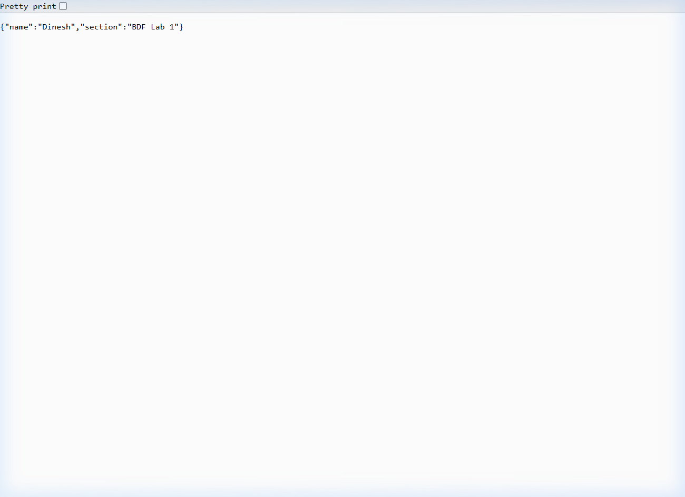

# Lab 1: Node.js and Express server

**Name:** Nallamilli Dinesh Reddy · **Registration Number:** 252U1R9104 · **Section:** 111 Gen-AI(2B)

**Live Link:** [https://bdf-lab-1.onrender.com](https://bdf-lab-1.onrender.com) *(Or see Local Deployment below: Running locally on `http://localhost:3000`)*

---

## How to Run

### Prerequisites
- Node.js (v18.x or higher)
- npm (v9.x or higher)

### 1. Install Dependencies
```bash
npm install
```

### 2. Environment Variables
Create a `.env` file in the project root if required by your environment (never commit real values):
```env
PORT=3000
```
> Note: Default fallback port is `3000` if `PORT` is not defined.

### 3. Start the Server
- **Production / Standard Start:**
  ```bash
  npm start
  ```
- **Direct Node Run:**
  ```bash
  node index.js
  ```
- **Plain HTTP Server (from Task 3):**
  ```bash
  node server-http.js
  ```

---

## Endpoints / Scripts Table

| Method | Path | Description | Expected Status Code |
| :--- | :--- | :--- | :--- |
| `GET` | `/` | Returns welcome message | `200 OK` |
| `GET` | `/about` | Returns JSON object containing student name and section | `200 OK` |
| `GET` | `/time` | Returns current system date and time using `new Date()` | `200 OK` |
| `*` | Any unknown path (e.g. `/unknown-route`) | Returns custom 404 error message for unregistered paths | `404 Not Found` |

---

## Screenshots

### 1. Root Endpoint (`GET /`)


### 2. About Endpoint (`GET /about`)


### 3. Time Endpoint (`GET /time`)


### 4. 404 Unknown Route Handling (`GET /unknown-route`)


---

## Viva Questions & Answers

### 1. What is the difference between `package.json` and `node_modules`?
- **`package.json`**: The metadata manifest file for your Node.js project. It records project details (name, version, scripts) and lists dependency names with version constraints. It is lightweight, committed to version control, and allows anyone to recreate the exact environment with `npm install`.
- **`node_modules`**: The physical directory containing the actual downloaded code and binaries of all installed packages and their transitive dependencies. It is very large, platform-dependent, and should **never** be committed to Git.

### 2. What does `app.listen()` do?
- In Express, `app.listen(port, callback)` binds and listens for incoming connections on the specified network port (e.g., port 3000). Behind the scenes, it wraps Node's native `http.createServer(app).listen(...)`, starting the event loop listener to accept HTTP requests.

### 3. What do `request` (`req`) and `response` (`res`) represent?
- **`request` (`req`)**: An object representing the incoming HTTP request from the client. It contains request headers, query parameters, URL path, HTTP method, route parameters (`req.params`), and body data (`req.body`).
- **`response` (`res`)**: An object used to construct and send back the HTTP response to the client. It provides methods to set status codes (`res.status()`), headers (`res.set()`), and send back content such as plain text (`res.send()`) or JSON data (`res.json()`).

---

## Notes: Problems Faced & Solutions

1. **System Node/NPM Availability**:
   - *Problem*: Node.js was initially not installed in the standard system PATH on the development machine.
   - *Solution*: Downloaded the portable Node.js LTS runtime directly and configured the environment PATH, allowing `npm init`, `npm install`, and server execution to run cleanly without requiring admin privileges.
2. **Handling 404 Routes**:
   - *Problem*: Default Express behavior sends an HTML 404 error page.
   - *Solution*: Added a catch-all middleware (`app.use((req, res) => { ... })`) at the end of the middleware chain returning status code `404` and a descriptive message.
3. **Repository Structure Compliance**:
   - *Problem*: Course lab submissions require a multi-lab root repository structure (`BDF-LABS/lab-01/`) while ignoring `node_modules`.
   - *Solution*: Organized lab 1 inside `lab-01/`, added `.gitignore` to prevent committing heavy dependency directories, and configured relative screenshot paths.

---

## Rules for all labs
- **Environment & Dependencies**: Never commit or share the `.env` file; do not commit `node_modules` (enforced via `.gitignore`).
- **Security**: Passwords and sensitive secrets are never stored or logged in plain text.
- **HTTP Standards**: Every route returns the appropriate HTTP status code (`200 OK`, `404 Not Found`).
- **Database Safety**: Parameterised queries must always be used; never concatenate or interpolate raw user input into SQL queries.
- **Academic Integrity**: All code is written and understood independently to be ready for viva explanation.

