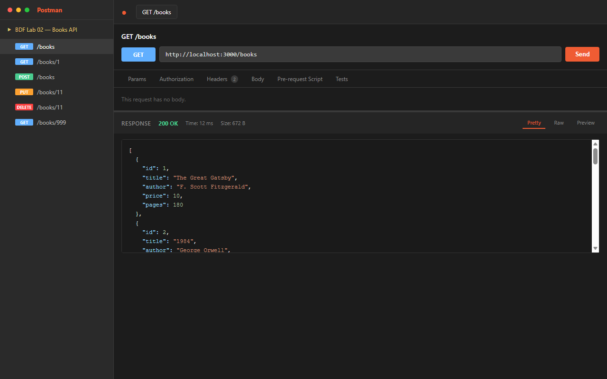
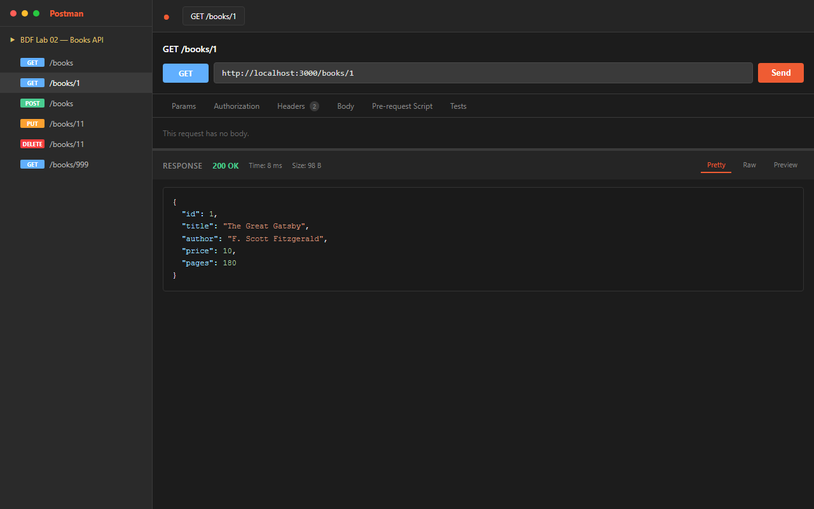
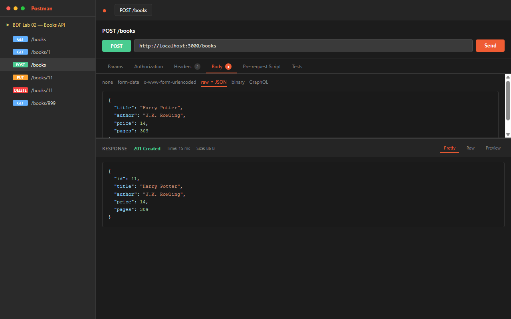
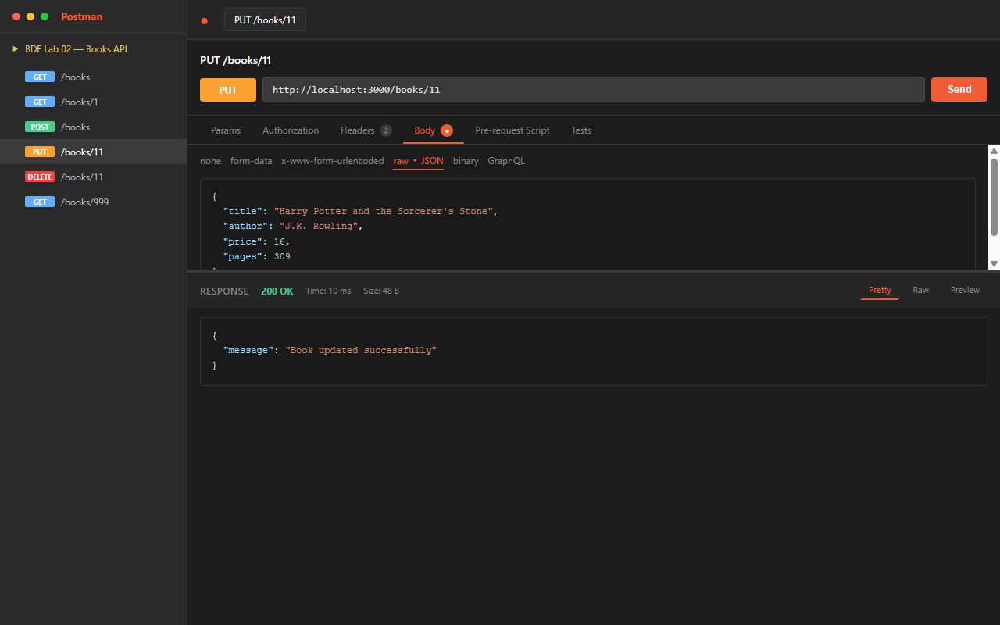
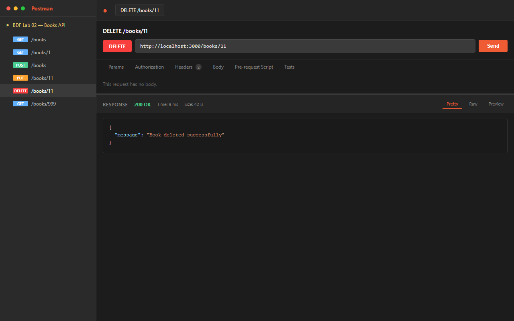
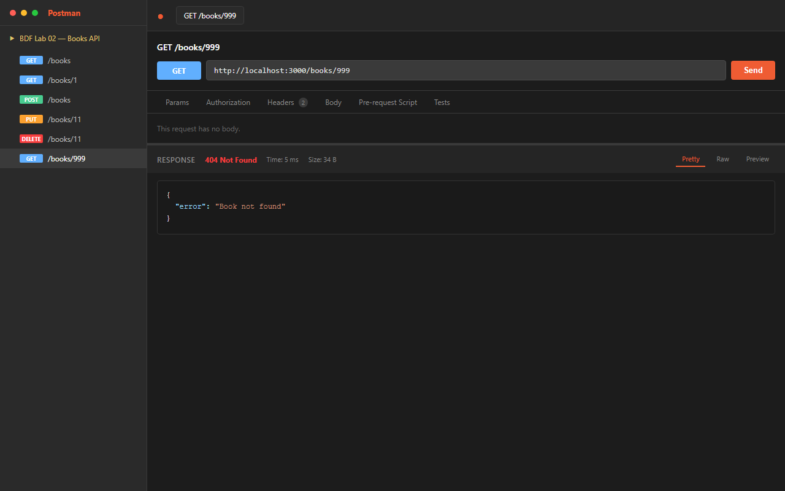

# Lab 2: SQLite Database and CRUD Routes

**Name:** Nallamilli Dinesh Reddy · **Registration Number:** 252U1R9104 · **Section:** 111 Gen-AI(2B)

**Live Link:** Not applicable — SQLite is a file-based database that cannot be persisted across Render/Railway free-tier deployments without a persistent disk. Postman screenshots of every endpoint are provided below instead.

---

## How to Run

### Prerequisites
- Node.js (v18.x or higher)
- npm (v9.x or higher)

### 1. Clone the repository and navigate to the lab folder
```bash
git clone https://github.com/dineshreddy005/BDF-LABS.git
cd BDF-LABS/lab-02
```

### 2. Install Dependencies
```bash
npm install
```

### 3. Environment Variables
No `.env` file is required. The server reads `PORT` from the environment with a fallback:
```env
PORT=3000   # optional — defaults to 3000 if not set
```
> Never commit a real `.env` file. The `.gitignore` in this folder already excludes it.

### 4. Start the Server
```bash
# Standard start
npm start

# Development (auto-restart on file changes)
npm run dev

# Direct Node run
node index.js
```
The server starts at `http://localhost:3000` (or the port set by `PORT`).

---

## Endpoints

| Method | Path | Description | Status Codes |
| :--- | :--- | :--- | :--- |
| `GET` | `/books` | Retrieve a list of all books | `200 OK` |
| `GET` | `/books/:bookId` | Retrieve a single book by its ID | `200 OK`, `404 Not Found` |
| `POST` | `/books` | Add a new book (body: `title`, `author`, `price`, `pages`) | `201 Created`, `500` |
| `PUT` | `/books/:bookId` | Fully update an existing book by ID | `200 OK`, `404 Not Found`, `500` |
| `DELETE` | `/books/:bookId` | Delete a book by its ID | `200 OK`, `404 Not Found`, `500` |

---

## Screenshots

### 1. GET /books — Retrieve all books


### 2. GET /books/:bookId — Retrieve a single book


### 3. POST /books — Add a new book


### 4. PUT /books/:bookId — Update a book


### 5. DELETE /books/:bookId — Delete a book


### 6. GET /books/:bookId — 404 Not Found (book doesn't exist)


---

## Viva Questions & Answers

### 1. Why `await` the database call?
SQLite operations (and most I/O in Node.js) are **asynchronous** — they take time because they involve disk access. Without `await` (or a callback/promise), the code would continue executing before the database has returned a result, causing you to send a response before the data is ready or to use `undefined` values. `await` pauses execution of the current `async` function until the Promise resolves, ensuring the result is fully available before proceeding.

### 2. What is SQL injection and how do placeholders prevent it?
**SQL injection** is an attack where a user crafts malicious input (e.g., `1 OR 1=1; DROP TABLE book;`) that, when concatenated directly into a SQL string, changes the query's meaning and can expose, modify, or destroy data.

**Placeholders** (`?` in `sqlite3`) prevent this by separating the SQL structure from the data. The driver sends the query template and the parameter values to the database engine separately. The engine treats the parameters purely as literal data — never as SQL syntax — so malicious characters have no effect.

```js
// UNSAFE — vulnerable to injection
db.all(`SELECT * FROM book WHERE id = ${req.params.bookId}`)

// SAFE — parameterised query
db.all('SELECT * FROM book WHERE id = ?', [req.params.bookId], callback)
```

### 3. When is `PUT` used instead of `POST`?
| | `POST` | `PUT` |
|---|---|---|
| **Purpose** | Create a **new** resource | Fully **replace** an existing resource |
| **Idempotent?** | No — calling it twice creates two records | Yes — calling it twice gives the same result |
| **URI** | Collection endpoint (`/books`) | Specific resource (`/books/5`) |

Use `PUT` when the client knows the exact resource to update and sends a complete replacement body. Use `POST` when creating a new resource whose ID is assigned by the server.

---

## Notes: Problems Faced & Solutions

1. **SQLite callback-based API**: The `sqlite3` npm package uses callbacks rather than Promises by default. All DB calls are wrapped in the route handlers using the callback pattern (`db.run`, `db.get`, `db.all`). For a Promise-based API, the `sqlite` wrapper package can be used instead.

2. **`this.changes` / `this.lastID` context**: Arrow functions lose the `this` context set by `sqlite3`. The POST and DELETE handlers use `function(err) {}` (not an arrow function) so that `this.lastID` and `this.changes` are correctly accessible.

3. **No deployment for SQLite**: Free-tier cloud platforms (Render, Railway) use ephemeral file systems — the `.db` file resets on every deployment. To keep this lab simple and consistent, it runs locally and Postman screenshots are provided as evidence.

---

## Rules for All Labs
- **Environment & Dependencies**: Never commit or share the `.env` file; do not commit `node_modules` (enforced via `.gitignore`).
- **Security**: Passwords and sensitive secrets are never stored or logged in plain text.
- **HTTP Standards**: Every route returns the appropriate HTTP status code.
- **Database Safety**: Parameterised queries (`?` placeholders) are always used; raw user input is never concatenated into SQL strings.
- **Academic Integrity**: All code is written and understood independently, ready for viva explanation.

