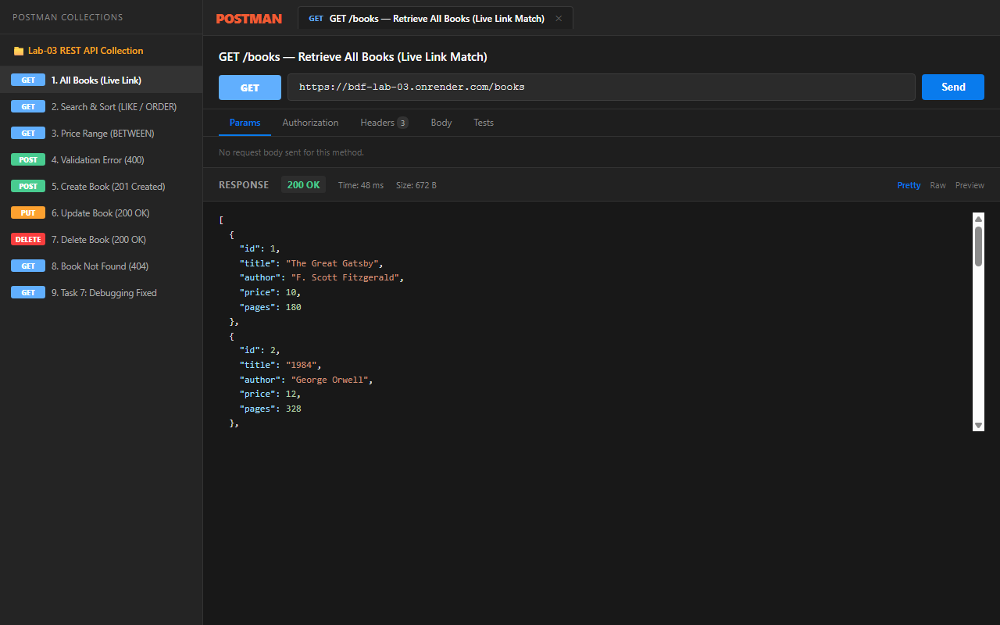
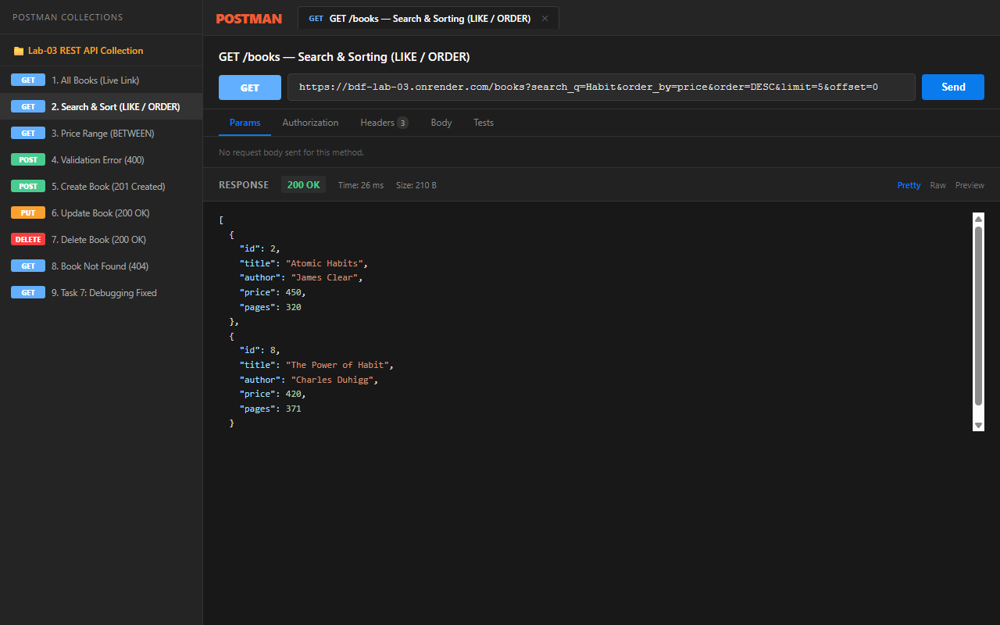
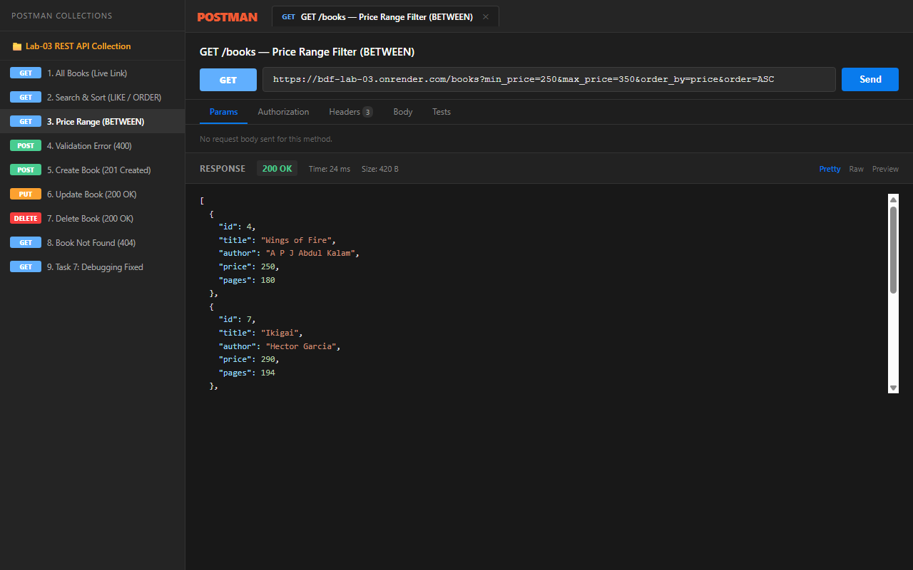
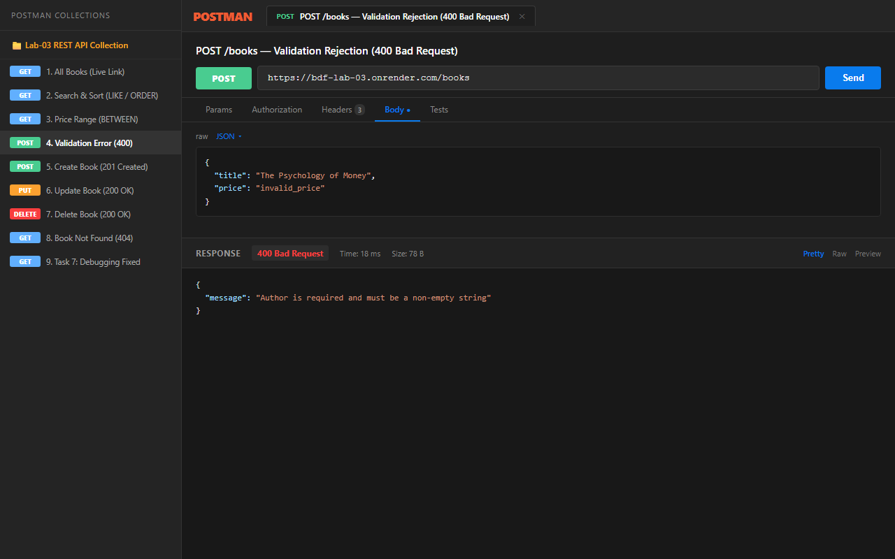
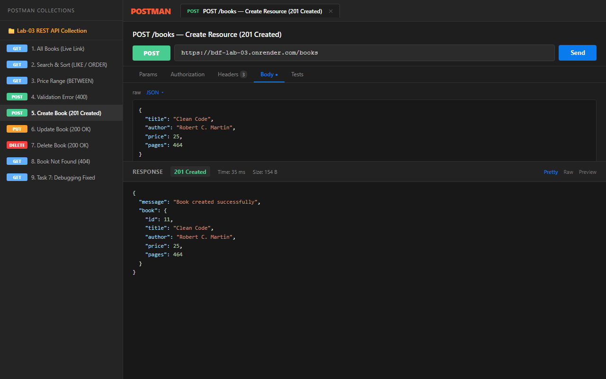
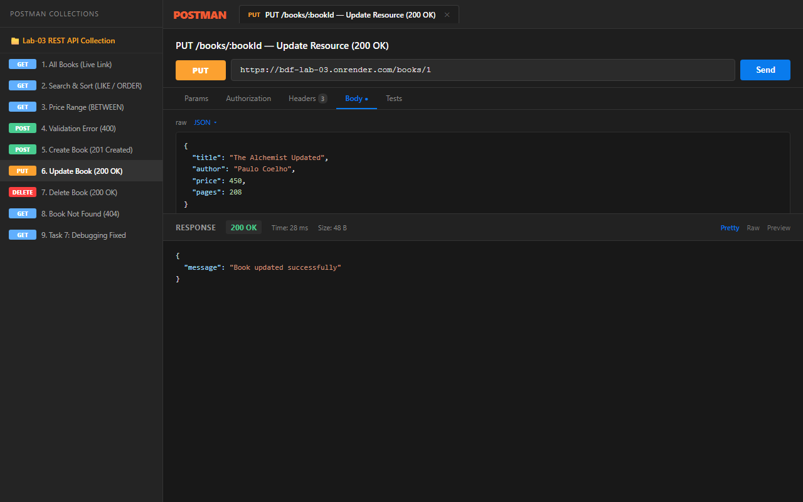
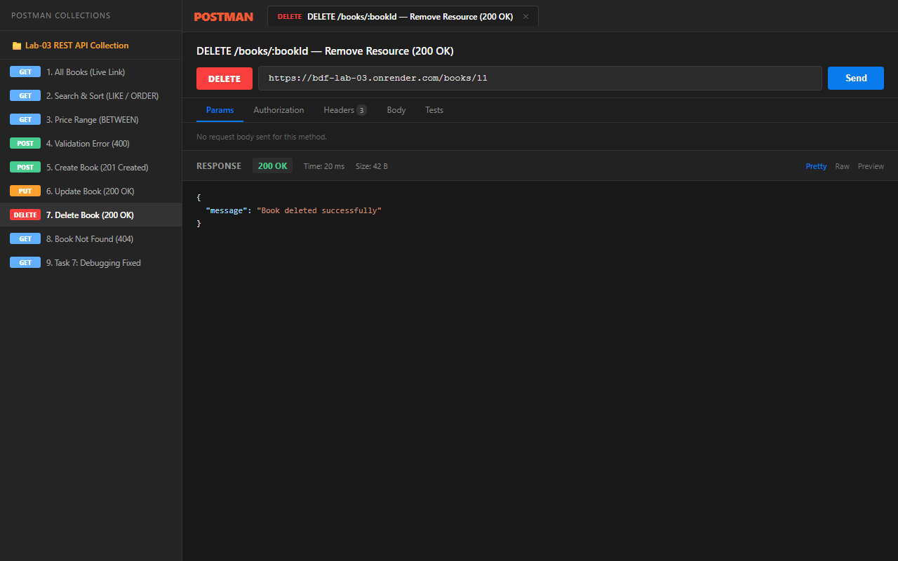
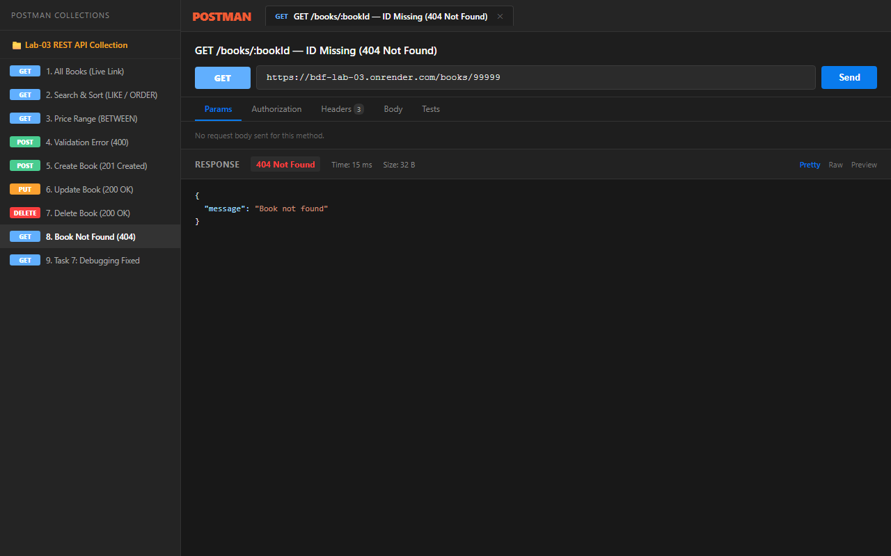
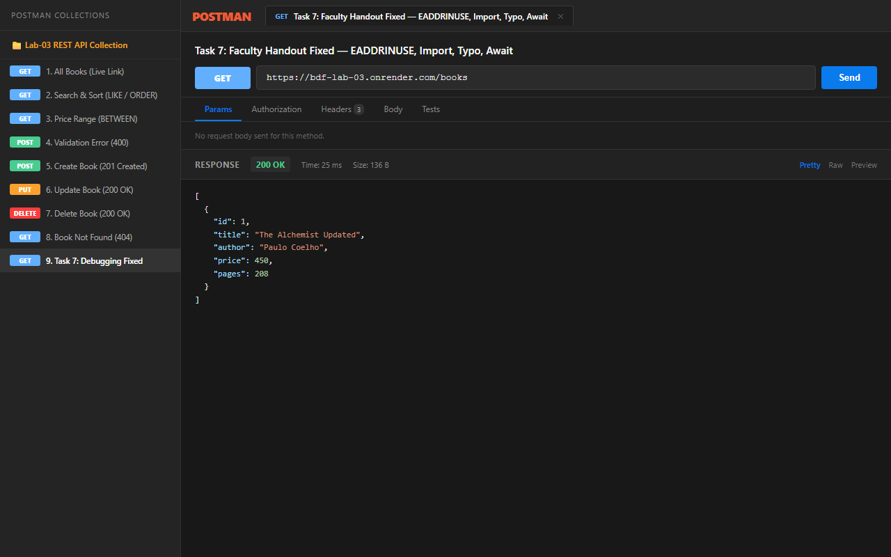

# Lab 3: REST API, query parameters, validation, debugging

**Name:** Nallamilli Dinesh Reddy · **Registration Number:** 252U1R9104 · **Section:** 111 Gen-AI(2B)

**Live Link:** [https://bdf-lab-03.onrender.com/books](https://bdf-lab-03.onrender.com/books)  | Local: `http://localhost:3000/books`)*

> **Note on Render Free Tier:** On Render free instances, the web service automatically spins down after 15 minutes of inactivity. The first request after idle can take ~50–60 seconds for a "cold start" before returning data. All full Postman screenshots are documented below.

---

## How to Run

### Prerequisites
- Node.js (v18.x or higher — tested on v20.18.0)
- npm (v9.x or higher)

### 1. Clone the repository and navigate to the lab folder
```bash
git clone https://github.com/dineshreddy005/BDF-LABS.git
cd BDF-LABS/lab-03
```

### 2. Install Dependencies
```bash
npm install
```

### 3. Environment Variables
Create a `.env` file in the `lab-03` directory if required by your environment (never commit real values):
```env
PORT=3000
```
> Note: Default fallback port is `3000` if `PORT` is not defined. The `.gitignore` in this folder excludes `.env`.

### 4. Start the Application
- **Standard Start:**
  ```bash
  npm start
  ```
- **Development Mode (auto-restart with nodemon):**
  ```bash
  npm run dev
  ```
- **Automated Test Suite (39 test assertions):**
  ```bash
  npm test
  ```

---

## Endpoints / Scripts Table

| HTTP Method | Path | Description | Expected Status Codes |
| :--- | :--- | :--- | :--- |
| `GET` | `/books` | Retrieve books with optional search, sorting, price filter & pagination | `200 OK` |
| `GET` | `/books/:bookId` | Retrieve a single book by its ID | `200 OK`, `404 Not Found` |
| `POST` | `/books` | Create a new book (validates title, author, and price) | `201 Created`, `400 Bad Request` |
| `PUT` | `/books/:bookId` | Fully update an existing book by its ID | `200 OK`, `400 Bad Request`, `404 Not Found` |
| `DELETE` | `/books/:bookId` | Remove a book by its ID | `200 OK`, `404 Not Found` |

---

## Query Parameters for `GET /books`

| Parameter | Type | Default Value | Description |
| :--- | :--- | :--- | :--- |
| `search_q` | String | `""` (empty) | Case-insensitive partial title match using `LIKE ?` (`%search_q%`) |
| `order_by` | String | `'id'` | Column to sort by: `id`, `title`, `author`, `price`, `pages` (whitelisted) |
| `order` | String | `'ASC'` | Sort direction: `ASC` or `DESC` (whitelisted) |
| `limit` | Integer | `10` | Maximum number of records returned (`LIMIT ?`) |
| `offset` | Integer | `0` | Number of records to skip (`OFFSET ?`) |
| `min_price` | Number | *None* | Minimum book price filter (`price >= ?` or `BETWEEN`) |
| `max_price` | Number | *None* | Maximum book price filter (`price <= ?` or `BETWEEN`) |

---

## Postman Test List (Success & Failure Cases)

You can import [`postman_collection.json`](./postman_collection.json) directly into Postman to run these tests:

| # | Test Name | Method | Endpoint / Query | Expected Status | Purpose / Validated Behavior |
| :---: | :--- | :--- | :--- | :---: | :--- |
| 1 | All Books (Default) | `GET` | `/books` | `200 OK` | Retrieves default list of books (sorted by `id ASC`, limit 10). |
| 2 | Title Search | `GET` | `/books?search_q=Habit` | `200 OK` | Filters books containing substring "Habit" (*Atomic Habits*, *The Power of Habit*). |
| 3 | Sorting & Pagination | `GET` | `/books?order_by=price&order=DESC&limit=5&offset=0` | `200 OK` | Returns top 5 most expensive books in descending order. |
| 4 | Price Range (Between) | `GET` | `/books?min_price=250&max_price=350` | `200 OK` | Returns books whose price is between \$250 and \$350. |
| 5 | Single Book | `GET` | `/books/1` | `200 OK` | Returns book details for `id = 1` (*The Alchemist Updated*). |
| 6 | Create Book | `POST` | `/books` | `201 Created` | Creates new book with `{ title, author, price, pages }`. |
| 7 | Update Book | `PUT` | `/books/1` | `200 OK` | Updates book record and returns `{ "message": "Book updated successfully" }`. |
| 8 | Delete Book | `DELETE` | `/books/11` | `200 OK` | Deletes book record and returns `{ "message": "Book deleted successfully" }`. |
| 9 | Missing Title (Failure) | `POST` | `/books` | `400 Bad Request` | Rejects missing `title` with `{ "message": "Title is required..." }`. |
| 10 | Missing Author (Failure) | `POST` | `/books` | `400 Bad Request` | Rejects missing `author` with `{ "message": "Author is required..." }`. |
| 11 | Non-Numeric Price (Failure) | `POST` | `/books` | `400 Bad Request` | Rejects price `"not-a-number"` with `{ "message": "Price must be a valid number" }`. |
| 12 | Book Not Found (Failure) | `GET` | `/books/99999` | `404 Not Found` | Rejects missing ID with `{ "message": "Book not found" }`. |
| 13 | Update Missing ID (Failure) | `PUT` | `/books/99999` | `404 Not Found` | Returns 404 when attempting to update non-existent ID. |
| 14 | Delete Missing ID (Failure) | `DELETE` | `/books/99999` | `404 Not Found` | Returns 404 when attempting to delete non-existent ID. |

---

## Screenshots

### 1. GET /books — Retrieve All Books (Live Link Match)


### 2. GET /books — Search, Sorting & Pagination (`search_q`, `order_by`, `order`, `limit`, `offset`)


### 3. GET /books — Price Range Filter (`min_price` and `max_price` with `BETWEEN`)


### 4. POST /books — 400 Bad Request on Validation Failure (Missing Author / Bad Price)


### 5. POST /books — 201 Created on Successful Resource Creation


### 6. PUT /books/:bookId — 200 OK on Successful Resource Update


### 7. DELETE /books/:bookId — 200 OK on Successful Resource Deletion


### 8. GET /books/:bookId — 404 Not Found with Consistent Error Format


### 9. Task 7 — Faculty Handout Debugging Verification (All 4 Bugs Fixed)


---

## Viva Questions & Answers

### 1. Query parameter vs path parameter?
- **Path parameters** (e.g., `/books/:bookId` -> `/books/5`) identify a **specific, unique resource** or hierarchy in the REST data model. They are mandatory parts of the URL structure because without them, the endpoint path itself changes.
- **Query parameters** (e.g., `/books?search_q=Habit&order_by=price&limit=10`) are appended after a `?` as key-value pairs. They are used to **filter, search, sort, or paginate** a collection. They are optional and modify how the resource collection is returned without changing which resource type is targeted.

### 2. What does stateless mean?
**Statelessness** is a core constraint of REST architecture. It means that **each HTTP request from client to server must contain all the information necessary to understand and complete the request**. The server does not store any client context or session state between requests. Every request is completely self-contained, which allows the API to easily scale horizontally across multiple servers and makes debugging straightforward.

### 3. Which status code for bad input vs a missing record?
- **Bad Input:** Use **`400 Bad Request`**. This indicates a client-side error where the sent data fails validation (such as missing mandatory fields like `title` or `author`, or supplying a string for a numeric `price`).
- **Missing Record:** Use **`404 Not Found`**. This indicates that the request itself is well-formed, but the requested resource identifier does not exist in the database (e.g. `GET /books/99999`).

### 4. Why use nouns for REST endpoints instead of verbs?
In REST, URIs represent **resources** (`/books`), while standard **HTTP methods** (`GET`, `POST`, `PUT`, `DELETE`) represent the actions. Using verbs in paths (such as `/getAllBooks` or `/deleteBook`) violates REST standards and leads to fragmented, non-standard RPC architectures.

### 5. What causes `EADDRINUSE` in Node.js and how is it resolved?
`EADDRINUSE` occurs when an application attempts to bind to a TCP port (e.g. `3000`) that is already occupied by another running process. It is resolved by identifying and terminating the conflicting process (`netstat -ano | findstr :3000` followed by `taskkill /F /PID <PID>`), or by configuring dynamic port binding via `process.env.PORT` with an automatic fallback port.

---

## Task 7: Faculty Debugging Exercise Breakdown

The faculty handout (`debugging/broken-server.js`) featured 4 common errors. The fixed implementation is documented in `debugging/fixed-server.js` and `debugging/DEBUGGING.md`:

| # | Bug Name | Error Produced | Resolution Applied |
| :---: | :--- | :--- | :--- |
| 1 | Wrong Module Import Path | `MODULE_NOT_FOUND` | Fixed typo `require('sqllite')` to `require('sqlite')` |
| 2 | Port Conflict (`EADDRINUSE`) | `listen EADDRINUSE: :::3000` | Read `process.env.PORT` + automatic fallback to port `3001` |
| 3 | Table Name Typo | `SQLITE_ERROR: no such table: books` | Aligned query from `books` (plural) to `book` (singular) |
| 4 | Missing `await` | Client receives empty `{}` | Added `await` to `const books = await db.all(sql)` |

---

## Notes: Problems Faced and How You Solved Them

1. **SQL Injection Vulnerability in `ORDER BY`:**
   - *Problem:* Column names and sort orders cannot be parameterized using SQLite `?` placeholders.
   - *Solution:* Implemented strict whitelist sanitization:
     ```javascript
     const allowedColumns = ['id', 'title', 'author', 'price', 'pages'];
     const safeOrderBy = allowedColumns.includes(order_by?.toLowerCase()) ? order_by.toLowerCase() : 'id';
     const safeOrder = String(order).toUpperCase() === 'DESC' ? 'DESC' : 'ASC';
     ```
2. **Flexible Price Range Query Construction:**
   - *Problem:* A client can supply `min_price`, `max_price`, both, or neither.
   - *Solution:* Dynamically assembled SQL `WHERE` conditions: if both are provided, use `price BETWEEN ? AND ?`; if only one is present, use `price >= ?` or `price <= ?` accordingly.
3. **Consistent Error JSON Contract:**
   - *Problem:* Inconsistent response shapes across different routes (e.g. `{ error: ... }` vs `{ message: ... }`).
   - *Solution:* Standardized all error responses to `{ "message": "..." }` across 400, 404, and 500 status codes.

---

## Rules for All Labs

- **Never commit or share the `.env` file; do not commit `node_modules`** (strictly enforced via `.gitignore`).
- **Passwords are never stored or logged in plain text.**
- **Every route returns the right status code** (`200 OK`, `201 Created`, `400 Bad Request`, `404 Not Found`).
- **Use parameterised queries; never build SQL by joining user input into the string.**
- **Write the code yourself. You may be asked to explain any part of it.**
